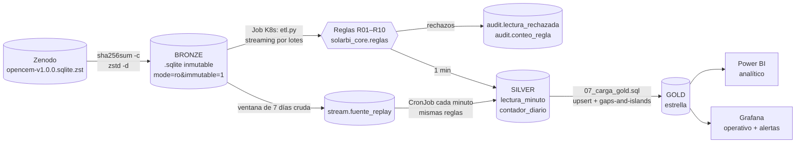

# SolarBI — Solución de BI de extremo a extremo para la microrred híbrida OpenCEM

**Taller 6 · Inteligencia de Negocios · Institución Universitaria Pascual Bravo · 2026-II**
Enfoque: **Línea 1 — auditoría y calidad de la telemetría**

> *From inverter telemetry to actionable insights: a containerized, Kubernetes-orchestrated BI pipeline for a hybrid microgrid.*

Todas las cifras de la fuente que aparecen en este informe provienen de los archivos de soporte publicados con el dataset (`validation_results.json`, `column_dictionary.csv`, `schema.sql`, `provenance.json` e `import_derived_telemetry_context.sql`). Las cifras que solo existen después de correr el ETL sobre el `.sqlite` real (kWh por mes, autosuficiencia, etc.) se marcan como **[a medir]**: el informe no las inventa.

---

## 0. Diagnóstico de la fuente (insumo para todo lo demás)

### 0.1 Inventario

| Tabla | Filas | Columnas | Cobertura (hora local Asia/Shanghai) | Uso en SolarBI |
|---|---:|---:|---|---|
| `analog_measurements` | 2 989 759 | 44 | 12-jul-2025 21:31 → 13-jul-2026 13:13 | Hechos de energía, calidad y eventos derivados |
| `status` | 2 240 052 | 20 | igual | Eventos `ALARMA_SISTEMA` (`sysalarmflag`) |
| `statistics` | 2 285 904 | 31 | igual | Contadores diarios para **conciliación** |
| `settings` | 2 284 775 | 176 | igual | Atributos SCD2 de `dim_inversor` |
| `fault_history` | 2 129 517 | 66 | igual | Eventos `FALLA_HISTORICA` (tiempos calibrados) |
| `specs` | 1 333 174 | 16 | 12-jul-2025 → **03-feb-2026** | Versión de protocolo (la tabla se corta en febrero) |
| `totals` | 2 279 918 | 21 | igual que analog | No usada (redundante con analog para los KPIs) |
| `context` | 25 178 | 5 | **01-may-2024 → 22-jul-2026** | `fact_contexto` (JSON) |

Por inversor: 1 610 276 lecturas analógicas (inv. 1) y 1 379 483 (inv. 2). El contexto desborda la ventana eléctrica por ambos lados: todo cruce contexto–telemetría se recorta a la ventana eléctrica.

### 0.2 Problemas de calidad detectados (con evidencia)

| # | Hallazgo | Evidencia en la fuente | Tratamiento |
|---|---|---|---|
| 1 | **Tramas vacías completas** | ≈ 58 000 NULL en *cada* columna analógica (1,94 %), con conteos casi idénticos entre columnas | Regla R01: se rechaza la fila |
| 2 | **Centinela de temperatura 120 °C** | 99,93 % de filas (inv. 1) y 95,87 % (inv. 2); los propios autores lo marcan como `telemetry_quality_note` | R06: se anula el campo; la fila sigue siendo válida para energía |
| 3 | **Huecos de registro** | Mediana de cadencia 12,6 s; p95 59,7 s; p99 111 s; 117 (inv. 1) y 40 (inv. 2) huecos > 10 min; 3 huecos > 1 día por inversor; máximo **26,1 días**, idéntico en ambos inversores | R10: no se integra energía en Δt > 120 s; huecos > 600 s → evento `HUECO_REGISTRO` (categoría *Registro*) |
| 4 | **Convención de signo de `battcurr` contradictoria** | El diccionario dice "positivo = descarga"; el pipeline derivado de los autores etiqueta `battery_discharging` con `battcurr ≤ −5 A` | El ETL decide con evidencia física: correlación entre corriente media horaria y ΔSoC; el signo queda registrado en `audit.etl_run.signo_battcurr` |
| 5 | **Identidad P = V·I del PV fuera de ±10 %** | 3,2 % (inv. 1) y 0,9 % (inv. 2) de las filas con P ≥ 100 W | R07: lectura *sospechosa* (cuenta para auditoría, no se descarta) |
| 6 | **Potencia activa > aparente + 50 VA** | 3 574 filas (inv. 1) y 237 (inv. 2) | R08: sospechosa |
| 7 | **Metadatos de unidad dudosos** | `outsumw` declarada "unitless" pese a ser potencia; `generatedpowerq_a` declarada en W cuando Q es reactiva (var) y `generatedpowers_a` en W cuando S es aparente (VA) | Esas columnas no alimentan KPIs; se usan `outw_a`, `pv1power` y `linepowerw_a`, cuya unidad se confirma por identidades físicas (§3.3) |
| 8 | **Columnas estructuralmente vacías** | `status.derinverterstate` 99,96 % NULL; `totals.bmsreqchgvolt` 99,7 % NULL | Excluidas del modelo |
| 9 | **Tablas con cadencias distintas** | `analog` 2,99 M filas vs `status` 2,24 M: no comparten todos los `read_ts` | Integración por minuto, no por timestamp exacto |
| 10 | **Contadores del inversor ≠ energía integrada** | Los autores comparan la energía PV diaria integrada con el contador del equipo: MAPE 19,7 % (inv. 1, 254 días) y 19,8 % (inv. 2, 183 días) | Tolerancia de conciliación del 20 % y dictamen por día (§4.2) |
| 11 | **Solo existe el canal PV 1** | `pv2*`/`pv3*` fueron podados por estar inactivos | E_PV = Σ `pv1power`·Δt |
| 12 | **Sin irradiancia ni potencia nominal (kWp)** | No hay piranómetro ni placa en el esquema | El Performance Ratio no se puede calcular (§1.4) |

Integridad confirmada por la fuente: `integrity_check = ok`, 0 llaves duplicadas, 0 JSON inválidos, SoC y frecuencias siempre dentro de rango, 0 potencias PV negativas. Aun así, las reglas R02–R05 se mantienen como **guardas**, porque el simulador (y cualquier dato futuro) no trae esas garantías.

---

## 1. Estrategia SolarBI y KPIs

### 1.1 Stakeholders y preguntas de negocio

| Usuario | Pregunta de negocio | Herramienta | Frecuencia |
|---|---|---|---|
| Dirección de infraestructura | ¿Cuánta energía aporta el sol, cuánta se compra y cuánto cuesta? ¿Conviene invertir en más paneles o más batería? | Power BI (páginas 2 y 3) | Mensual |
| **Analista de datos / auditor (Línea 1)** | ¿Puedo confiar en las cifras? ¿Qué porcentaje de lecturas es válido, qué regla falla más, qué días no concilian y por qué? | Power BI (página 1), DBeaver | Semanal |
| Equipo de mantenimiento | ¿Está la microrred sana *ahora*? ¿Hay batería baja, telemetría detenida o calidad degradada? | Grafana + alertas | Continuo (≤ 1 min) |
| Usuarios de cómputo (GPU/CPU) | ¿Cuánto consume y cuesta un entrenamiento o una compilación? | DBeaver (Q1), Power BI | Por demanda |
| TI / plataforma | ¿El servicio se levanta, escala y se recupera sin intervención? | `kubectl` | Por despliegue |

**Principio rector de la Línea 1:** ningún KPI energético se publica sin su KPI de confianza al lado. Cada tarjeta de energía en Power BI va acompañada de `% lecturas válidas` y `disponibilidad` del mismo contexto de filtro.

### 1.2 Catálogo de indicadores

Notación: Δtᵢ = tiempo hasta la lectura siguiente del mismo inversor; solo se integra si Δtᵢ ≤ 120 s y la lectura es válida. Las energías se calculan por **retención de orden cero** (la potencia leída se sostiene hasta la lectura siguiente; es la semántica de un *snapshot* Modbus).

| # | Indicador | Fórmula | Unidad | Granularidad | Meta / umbral | Fuente | Usuario |
|---|---|---|---|---|---|---|---|
| **Calidad del dato (Línea 1)** |||||||
| Q1 | **% lecturas válidas** | lecturas válidas / lecturas recibidas (sin duplicados) | % | inversor · minuto · día · mes · periodo | ≥ 98 % (la línea base de tramas nulas es 1,94 %); alerta operativa < 90 % en 15 min | `fact_disponibilidad_diaria`, `fact_telemetria_minuto` | Auditor, mantenimiento |
| Q2 | **Disponibilidad del registro** | Σ segundos cubiertos por lecturas válidas (Δt ≤ 120 s) / (días calendario × 86 400 × n.º de inversores) | % | inversor · día · mes · periodo | ≥ 95 % mensual | `fact_disponibilidad_diaria` | Auditor, dirección |
| Q3 | Tasa de violación por regla | lecturas afectadas / lecturas evaluadas, por regla | % | inversor · día · regla | R01 ≤ 2 %; R07 ≤ 5 % | `fact_calidad_diaria` × `dim_regla_calidad` | Auditor |
| Q4 | Huecos > 10 min | conteo de Δt > 600 s | n.º | inversor · día · mes | 0 por día | `fact_disponibilidad_diaria` | Auditor, TI |
| Q5 | **Desviación de conciliación PV** | (E_PV integrada − contador `pvgeneratenergytoday`) / contador | % | inversor · día | \|desv.\| ≤ 20 % (referencia: MAPE de los autores 19,7–19,8 %) | `fact_conciliacion_diaria` | Auditor |
| Q6 | Frescura del dato | ahora − último minuto recibido | s | inversor · ahora | < 300 s | `vw_estado_actual` | Mantenimiento |
| **Energía (mínimos del enunciado)** |||||||
| E1 | Energía solar generada | Σ max(`pv1power`, 0)·Δt / 3,6·10⁶ | kWh | inversor · minuto · día · mes · periodo | Tendencia; sin meta absoluta (falta kWp) | `fact_telemetria_minuto` | Dirección |
| E2 | Energía entregada a la carga | Σ max(`outw_a`, 0)·Δt / 3,6·10⁶ | kWh | ídem | — | ídem | Dirección |
| E3 | Energía importada de la red | Σ max(`linepowerw_a`, 0)·Δt / 3,6·10⁶ | kWh | ídem | Minimizar | ídem | Dirección |
| E4 | Energía de carga / descarga de batería | Σ max(∓V·I·signo, 0)·Δt | kWh | ídem | — | ídem | Dirección |
| **Propios del sistema híbrido (no pedidos en el enunciado)** |||||||
| H1 | **Autosuficiencia** | 1 − E3 / E2 | % | inversor · día · mes · franja | ≥ 80 % [meta a validar con la línea base medida] | ídem | Dirección |
| H2 | **Cierre del balance** | (E1 + E3 + E_desc) − (E2 + E_carga), sobre las entradas | % | inversor · día · mes | 0–15 % (pérdidas de conversión); **negativo = error de medición** | ídem | Auditor, dirección |
| H3 | Ciclos equivalentes de batería | E_desc / (Ah declarados × V nominal) | ciclos | inversor · mes | Seguimiento de desgaste | `fact_telemetria_minuto` + `dim_inversor` | Mantenimiento |
| H4 | Dependencia nocturna de red | E3 fuera de la ventana solar / E3 total | % | inversor · mes | Si es alta, una batería más grande resuelve más que más paneles | ídem + `dim_tiempo` | Dirección |
| H5 | Minutos con SoC bajo | Σ minutos de eventos `SOC_BAJO` | min | inversor · día | 0 | `fact_evento_operativo` | Mantenimiento |
| **Económico** |||||||
| C1 | **Costo de energía de red** | E3 × 920 COP/kWh | COP | inversor · día · mes · periodo | Reducción mes a mes | `fact_telemetria_minuto` + parámetro | Dirección |
| C2 | **Ahorro por autosuficiencia** | (E2 − E3) × 920 COP/kWh | COP | ídem | — | ídem | Dirección |
| C3 | Costo por sesión de cómputo | E2 durante el intervalo del contexto × 920 | COP/sesión | sesión | — | `fact_contexto` + telemetría | Usuarios GPU/CPU |

**Justificación de los indicadores híbridos.** H1 es *el* indicador de valor de una microrred con batería: mide cuánto de lo que se consume no se compra. H2 es a la vez energético y de calidad: si las entradas no cubren las salidas, algún canal está mal medido o tiene un signo invertido. Por eso sirve para detectar un signo invertido como el que permite la ambigüedad documental de `battcurr`. H4 separa la decisión de inversión: la red que se compra de noche no se arregla con más paneles.

**Tarifa.** El escenario base usa **920 COP/kWh**, la tarifa adoptada por el equipo. Queda versionada en `gold.dim_tarifa` (con vigencias que no se traslapan, garantizado por un `EXCLUDE USING gist`) y en `audit.parametro`, y se puede sensibilizar con el parámetro *what-if* de Power BI (600–1 500 COP/kWh). En el PDF hay que citar el pliego tarifario del que se tomó y el mes; el modelo no depende del valor.

### 1.3 Por qué `linepowerw_a` es "red" y `outw_a` es "carga"

El simulador oficial del dataset (`opencem/dataset.py`) modela la red con `linepowerw_a`/`linepowerva_a` y la salida AC con `outw_a`/`outva_a`. Se adopta la misma semántica para no contradecir a los autores. `gridpowerw_a` se conserva en Bronze, pero no alimenta KPIs mientras no se documente su significado.

### 1.4 El indicador clásico que no se puede calcular: Performance Ratio (PR)

PR = (E_AC / P_nominal) / (H_POA / G_STC), según IEC 61724-1. Necesita **dos datos que la fuente no tiene**:

1. **Irradiancia en el plano del arreglo (H_POA)**: no hay piranómetro ni celda de referencia en ninguna tabla.
2. **Potencia nominal instalada (kWp)**: `specs` solo trae identidad y firmware, sin la placa del arreglo.

Por la misma razón tampoco se pueden calcular el *specific yield* (kWh/kWp) ni el factor de capacidad.

**Mitigación en tres niveles:**

| Nivel | Acción | Qué entrega | Limitación |
|---|---|---|---|
| Inmediato | **Índice de desempeño relativo (IDR)** = E_PV del día / percentil 90 de E_PV diaria del mismo mes y del mismo inversor | Detecta degradación, sombras o suciedad comparando el sistema consigo mismo | No es comparable con otras plantas |
| Corto plazo | Irradiancia de cielo despejado modelada (p. ej. `pvlib`, ubicación Longgang–Shenzhen) + kWp como **parámetro what-if** en Power BI | PR *estimado* con escenario explícito | Depende del supuesto de kWp; sobrestima en días nublados |
| Corto plazo | Explorar las llaves del `context_type = weather_hourly` (Q6, `jsonb_object_keys`) por si traen radiación o nubosidad; el archivo de imágenes de cielo es una alternativa (fuera del alcance) | Proxy de nubosidad | Cobertura de imágenes solo desde mar-2026 |
| Estructural | Instalar un piranómetro (o celda de referencia) leído por el mismo bus Modbus, y registrar la placa del arreglo en `dim_inversor` | PR real según IEC 61724 | Inversión en hardware |

---

## 2. Modelo dimensional (capa Gold)

### 2.1 Elección: constelación de estrellas (star schema), no snowflake

Se eligió **estrella** porque: (a) las dimensiones son pequeñas (máximo 1 440 filas en `dim_tiempo`), así que normalizarlas no ahorra nada; (b) Power BI rinde mejor con relaciones 1:* directas de un solo salto; (c) Grafana escribe SQL a mano y cada *join* extra complica los paneles. Al haber cinco procesos de negocio que comparten dimensiones conformadas, el resultado es una **constelación de hechos** (galaxy).

```mermaid
erDiagram
    dim_fecha ||--o{ fact_telemetria_minuto : sk_fecha
    dim_tiempo ||--o{ fact_telemetria_minuto : sk_tiempo
    dim_inversor ||--o{ fact_telemetria_minuto : sk_inversor
    dim_fecha ||--o{ fact_calidad_diaria : sk_fecha
    dim_inversor ||--o{ fact_calidad_diaria : sk_inversor
    dim_regla_calidad ||--o{ fact_calidad_diaria : sk_regla
    dim_fecha ||--o{ fact_disponibilidad_diaria : sk_fecha
    dim_inversor ||--o{ fact_disponibilidad_diaria : sk_inversor
    dim_fecha ||--o{ fact_evento_operativo : sk_fecha
    dim_tiempo ||--o{ fact_evento_operativo : sk_tiempo
    dim_inversor ||--o{ fact_evento_operativo : sk_inversor
    dim_tipo_evento ||--o{ fact_evento_operativo : sk_tipo_evento
    dim_fecha ||--o{ fact_contexto : sk_fecha_inicio
    dim_inversor ||--o{ fact_contexto : sk_inversor
    dim_tipo_contexto ||--o{ fact_contexto : sk_tipo_contexto
    dim_fecha ||--o{ fact_conciliacion_diaria : sk_fecha
    dim_inversor ||--o{ fact_conciliacion_diaria : sk_inversor
```



### 2.2 Hechos y grano explícito

| Proceso de negocio | Tabla de hechos | **Grano (una fila =)** | Tipo | Medidas |
|---|---|---|---|---|
| P1 Medición energética | `fact_telemetria_minuto` | un inversor × un minuto UTC con ≥ 1 lectura recibida | Transaccional agregada | Energías (aditivas); SoC promedio y mínimo (semiaditivas: se promedian, nunca se suman); conteos de lecturas |
| P2 Auditoría de calidad | `fact_calidad_diaria` | un inversor × un día local × **una regla de calidad** | Snapshot periódico (incluye las reglas con 0 violaciones, para que el denominador sea completo) | lecturas evaluadas, lecturas afectadas |
| P2b Disponibilidad | `fact_disponibilidad_diaria` | un inversor × un día local | Snapshot periódico | lecturas recibidas y válidas, segundos cubiertos, huecos |
| P3 Eventos operativos | `fact_evento_operativo` | **una ocurrencia** de evento (inversor, tipo, instante de inicio) | Transaccional con duración (*accumulating-lite*) | conteo, duración (columna generada) |
| P4 Contexto operativo | `fact_contexto` | un registro de `context` (id de la fuente) | Hecho sin medidas (factless) con intervalo | duración; payload JSONB |
| P5 Conciliación | `fact_conciliacion_diaria` | un inversor × un día local | Snapshot periódico | kWh integrados, kWh del contador, desviación (generada) |

**Decisión sobre el SCD2 en hechos diarios.** Los hechos de grano diario se agregan por inversor *natural* y se asocian a la versión de `dim_inversor` vigente **al inicio del día local**. En las pruebas, asociarlos minuto a minuto partía un día en dos filas cuando la configuración cambiaba a mediodía; el defecto se detectó y se corrigió antes de entregar.

### 2.3 Dimensiones

| Dimensión | Llave | Atributos principales | Jerarquía | Origen |
|---|---|---|---|---|
| `dim_fecha` | `sk_fecha` = yyyymmdd (día **local** Asia/Shanghai) | año, semestre, trimestre, mes, semana ISO, día, fin de semana, estación | Año → Semestre → Trimestre → Mes → Día | Generada (`generate_series`) |
| `dim_tiempo` | `sk_tiempo` = hhmm | hora, minuto, **franja horaria**, ventana solar | Franja → Hora → Minuto | Generada |
| `dim_inversor` | `sk_inversor` (sustituta) + `inversor_id` (natural) | subsistema, versión de protocolo, Ah de batería, SoC de alarma, SoC de parada, vigencia | Instalación → Subsistema → Inversor | `settings`, `specs` |
| **`dim_regla_calidad`** ★ | `sk_regla` | código, nombre, dimensión DQ (completitud, validez, consistencia, unicidad, oportunidad, exactitud), nivel (fila/campo/intervalo), acción, severidad, expresión, evidencia | Dimensión DQ → Regla | **Construida** (no existe en la fuente) |
| **`dim_tipo_evento`** ★ | `sk_tipo_evento` | código, categoría (Red, Batería, Inversor, Registro), severidad, origen, criterio | Categoría → Tipo | **Construida** |
| `dim_tipo_contexto` | `sk_tipo_contexto` | `context_type`, familia, ¿explica carga eléctrica? | Familia → Tipo | Derivada del JSON |
| `dim_tarifa` | `sk_tarifa` | COP/kWh, vigencia, fuente | — | Parámetro del equipo |

★ Dimensiones construidas. `dim_regla_calidad` es la columna vertebral de la Línea 1: convierte cada regla del ETL en un miembro analizable (filtrable por dimensión DQ y por severidad), con su evidencia documentada en la propia fila.

**Catálogo de `dim_regla_calidad`:**

| Código | Dimensión DQ | Nivel | Acción | Sev. | Regla |
|---|---|---|---|:-:|---|
| R01_FRAME_NULO | Completitud | Fila | Rechazar | 3 | `pv1power, outw_a, battsoc, battvolt, linevolta` todos NULL |
| R02_DUPLICADO | Unicidad | Fila | Deduplicar | 3 | (inversor, read_ts) repetido |
| R03_SOC_RANGO | Validez | Fila | Rechazar | 3 | SoC ∉ [0, 100] |
| R04_FREC_RANGO | Validez | Fila | Rechazar | 3 | frecuencia ≠ 0 y ∉ [45, 65] Hz |
| R05_PV_NEGATIVA | Validez | Fila | Rechazar | 3 | `pv1power` < 0 |
| R06_TEMP_CENTINELA | Exactitud | Campo | Anular campo | 1 | temperatura = 120 °C |
| R07_IDENTIDAD_PV | Consistencia | Fila | Marcar sospechosa | 2 | \|P − V·I\| > 10 % con P ≥ 100 W |
| R08_ACTIVA_GT_APARENTE | Consistencia | Fila | Marcar sospechosa | 2 | \|P\| > S + 50 VA |
| R09_BAT_V_INCOHERENTE | Consistencia | Campo | Anular campo | 2 | 0 V de batería con SoC > 0 |
| R10_HUECO | Oportunidad | Intervalo | No integrar | 1 | Δt > 120 s |

**SCD (bonificación).** `dim_inversor` es **SCD Tipo 2** sobre `battpackrateah`, `batsoclowalarm` y `batstopsoc`. Se eligió Tipo 2, y no Tipo 1, porque el umbral de SoC de alarma *define* el evento `SOC_BAJO`: si se sobrescribiera, los eventos históricos se recalcularían con un umbral que no estaba vigente cuando ocurrieron. El ETL detecta los cambios con `lag()` dentro de SQLite y escribe `vigente_desde`/`vigente_hasta`, con un índice único parcial que garantiza una sola versión vigente por inversor.

### 2.4 Eventos operativos vs. datos inválidos

El criterio separa **lo que el sistema eléctrico hizo** de **lo que el registrador midió mal**:

| Pregunta | Dato inválido | Evento operativo real |
|---|---|---|
| ¿Viola un límite físico o una identidad? | Sí (SoC 150 %, P_PV < 0, P > S) | No: los valores son físicamente posibles |
| ¿Es coherente con las variables redundantes? | No (0 V de batería con SoC 60 %) | Sí (red en 0 V **y** carga alimentada por la batería **y** SoC bajando) |
| ¿Persiste? | Suele ser aislado | Dura minutos (se exigen ≥ 3 min para `SALIDA_AC_APAGADA`) |
| ¿Dónde vive? | `audit.lectura_rechazada` + `fact_calidad_diaria` | `fact_evento_operativo` |

Ejemplos que el modelo distingue:

- **`linefreq = 0` con `linevolta < 100 V`** → *no* es inválido (R04 excluye el 0 explícitamente): es el evento `RED_NO_DISPONIBLE`.
- **Hueco de 26 días** → no es una falla eléctrica: es el evento `HUECO_REGISTRO`, de categoría *Registro*, que se reporta aparte para no inflar la indisponibilidad de la microrred.
- **Temperatura de 120 °C** → no es un evento térmico: es un centinela. Se anula el campo y la lectura sigue sirviendo para energía.

Los eventos se modelan en una **tabla de hechos propia**, y no como banderas en la telemetría, porque tienen otro grano (una ocurrencia con duración) y otras preguntas (frecuencia, MTTR, duración acumulada).

### 2.5 Matriz de bus

| Proceso de negocio | dim_fecha | dim_tiempo | dim_inversor | dim_regla_calidad | dim_tipo_evento | dim_tipo_contexto | dim_tarifa |
|---|:-:|:-:|:-:|:-:|:-:|:-:|:-:|
| P1 Medición energética | ✔ | ✔ | ✔ | | | | ✔ (medida) |
| P2 Auditoría de calidad | ✔ | | ✔ | ✔ | | | |
| P2b Disponibilidad | ✔ | | ✔ | | | | |
| P3 Eventos operativos | ✔ | ✔ | ✔ | | ✔ | | |
| P4 Contexto operativo | ✔ | | ✔ (o −1) | | | ✔ | |
| P5 Conciliación | ✔ | | ✔ | | | | |

`dim_fecha`, `dim_inversor` y `dim_tiempo` son **dimensiones conformadas**: permiten preguntas que cruzan procesos, como "¿los días que no concilian (P5) son los de menor disponibilidad (P2b)?" (consulta Q5).

---

## 3. Diccionario de datos y DDL (PostgreSQL 16)

El DDL completo está en `sql/01…05`. Aquí van las decisiones y el diccionario de las tablas centrales.

### 3.1 Diccionario: `gold.fact_telemetria_minuto`

| Columna | Tipo | Llave | Regla de transformación | Linaje (origen) |
|---|---|---|---|---|
| sk_fecha | integer | FK → dim_fecha | `to_char(ts AT TIME ZONE 'Asia/Shanghai','YYYYMMDD')` | `analog_measurements.read_ts` |
| sk_tiempo | smallint | FK → dim_tiempo | `HH24MI` local | ídem |
| sk_inversor | integer | PK, FK → dim_inversor | versión SCD2 vigente en el minuto | `inverter` + `settings` |
| ts_minuto_utc | timestamptz | PK | `floor(read_ts / 60)·60` | `read_ts` |
| n_lecturas | integer | | lecturas recibidas en el minuto (tras R02) | conteo |
| n_validas | integer | | lecturas que superan R01–R05 | reglas |
| seg_cubiertos(_valid) | numeric(6,2) | | Σ Δt ≤ 120 s (de lecturas válidas) | `read_ts` |
| e_pv_kwh | numeric(12,6) | | Σ max(`pv1power`,0)·Δt / 3,6·10⁶ | `pv1power` (W) |
| e_carga_kwh | numeric(12,6) | | Σ max(`outw_a`,0)·Δt / 3,6·10⁶ | `outw_a` (W) |
| e_red_kwh | numeric(12,6) | | Σ max(`linepowerw_a`,0)·Δt / 3,6·10⁶ | `linepowerw_a` (W) |
| e_bat_carga/descarga_kwh | numeric(12,6) | | P_bat = `battvolt`·`battcurr`·signo; positiva → descarga | `battvolt` (V), `battcurr` (A) |
| soc_prom_pct / soc_min_pct | numeric / smallint | | promedio / mínimo de las lecturas válidas | `battsoc` (%) |
| origen | text | | `historico` (ETL) o `simulado` (CronJob) | — |

Los diccionarios de las demás tablas se generan desde los comentarios del DDL, y las reglas de cada medida están en `dim_regla_calidad.expresion`.

### 3.2 Restricciones e índices (justificados por consulta y volumen)

| Objeto | Decisión | Por qué |
|---|---|---|
| PK `(sk_inversor, ts_minuto_utc)` | Llave natural compuesta | Es la llave del upsert idempotente y resuelve "un inversor en un rango de tiempo" |
| `BRIN (ts_minuto_utc)` | En lugar de un B-tree | El tiempo crece de forma monótona con la carga: el BRIN ocupa KB frente a decenas de MB del B-tree y basta para los `$__timeFilter` de Grafana |
| `(sk_fecha, sk_inversor)` B-tree | Para Power BI y las vistas diarias | Las agregaciones por día e inversor son el patrón dominante |
| `GIN (payload jsonb_path_ops)` | En `fact_contexto` | Acelera `@>` (contención), el operador de Q1 |
| `GiST (tstzrange(inicio, fin))` | En `fact_contexto` | Cruce de intervalos de contexto con minutos de telemetría (`@>`, `&&`) |
| `CHECK` de rangos | SoC ∈ [0,100], n_validas ≤ n_lecturas, fin ≥ inicio | La base rechaza lo que el ETL no debería producir: defensa en profundidad |
| `EXCLUDE USING gist` en `dim_tarifa` | Vigencias sin traslape | Una fecha nunca tiene dos tarifas |
| Índice único parcial `WHERE es_vigente` | `dim_inversor` | Una sola versión vigente por inversor |
| Columnas `GENERATED ALWAYS … STORED` | `duracion_s`, `desv_pv_pct` | Calculadas una vez, imposibles de desincronizar |

Volumen esperado en Silver/Gold: entre 0,6 y 1,0 millones de filas-minuto (2,99 M lecturas con cadencia mediana de 12,6 s, menos los huecos). Es pequeño para PostgreSQL; los índices se eligieron por patrón de consulta, no por volumen.

### 3.3 Unidades declaradas y evidencia

| Variable | Unidad | Evidencia |
|---|---|---|
| `read_ts` | s Unix UTC | Diccionario + README ("fractional Unix seconds in UTC"); sitio en UTC+8 sin horario de verano |
| `pv1volt`, `pv1curr`, `pv1power` | V, A, W | Diccionario **y** identidad P ≈ V·I con MAE de 4,8 / 6,7 W y 96,8 % / 99,1 % de filas dentro de ±10 % |
| `outvolta`, `outcurra`, `outva_a` | V, A, VA | Identidad S ≈ V·I (MAPE 3,8 % / 1,8 %) |
| `battvolt` | V | Rango 21,8–57,6 V → banco de clase 48 V |
| `battsoc` | % | 0 valores fuera de [0, 100] |
| `outfreq`, `linefreq` | Hz | 0 valores fuera de rango; red de 50 Hz |
| `battcurr` | A, **signo a verificar** | Conflicto documental → se resuelve por correlación con ΔSoC (§0.2, hallazgo 4) |
| `temper1..4` | °C | Declarado, pero dominado por el centinela 120 → no apto para análisis térmico |
| `statistics.pvgeneratenergytoday` | kWh | Diccionario; contador que se reinicia a diario |

### 3.4 Consulta analítica con ventanas y JSONB (extracto de `sql/06`, Q1)

Pregunta: *¿cuánto sube la carga cuando se lanza un entrenamiento GPU o una compilación CPU, frente a la hora previa, y cuáles son las sesiones más costosas?*

```sql
WITH sesiones AS (
  SELECT c.contexto_id, c.inicio_utc, c.fin_utc, c.sk_inversor,
         c.payload->>'task_type'    AS tarea,              -- ->>  extracción como texto
         c.payload->>'context_type' AS tipo
  FROM gold.fact_contexto c
  WHERE c.payload ? 'task_type'                            -- ?    existencia de llave
    AND (c.payload @> '{"context_type": "gpu_cnn_training_workload"}'   -- @> contención (usa GIN)
      OR c.payload @> '{"context_type": "cpu_compilation_workload"}')
    AND c.sk_inversor <> -1
),
medicion AS (
  SELECT s.contexto_id, s.tipo, s.tarea,
         avg(f.e_carga_kwh * 60000) FILTER (WHERE tstzrange(s.inicio_utc, s.fin_utc) @> f.ts_minuto_utc) AS p_durante_w,
         avg(f.e_carga_kwh * 60000) FILTER (WHERE f.ts_minuto_utc < s.inicio_utc)                       AS p_previa_w,
         sum(f.e_carga_kwh)        FILTER (WHERE tstzrange(s.inicio_utc, s.fin_utc) @> f.ts_minuto_utc) AS e_sesion_kwh
  FROM sesiones s
  JOIN gold.dim_inversor di ON di.sk_inversor = s.sk_inversor
  JOIN gold.dim_inversor dv ON dv.inversor_id = di.inversor_id          -- todas las versiones SCD2
  JOIN gold.fact_telemetria_minuto f
    ON f.sk_inversor = dv.sk_inversor
   AND f.ts_minuto_utc >= s.inicio_utc - interval '1 hour' AND f.ts_minuto_utc < s.fin_utc
  GROUP BY s.contexto_id, s.tipo, s.tarea
)
SELECT tipo, tarea, contexto_id,
       round(p_previa_w) AS carga_previa_w, round(p_durante_w) AS carga_durante_w,
       round(p_durante_w - p_previa_w) AS delta_w,
       round(e_sesion_kwh * (SELECT valor FROM audit.parametro WHERE clave = 'tarifa_cop_kwh')) AS costo_cop,
       rank() OVER (PARTITION BY tipo ORDER BY p_durante_w - p_previa_w DESC NULLS LAST) AS ranking_impacto
FROM medicion
ORDER BY tipo, ranking_impacto;
```

Las otras seis consultas de `sql/06` cubren: balance mensual con `LAG` (variación mes a mes) y `SUM() OVER` (acumulado del año); % de válidas con media móvil de 7 días (`ROWS BETWEEN 6 PRECEDING`); cuartiles de compra de red por franja (`NTILE`); dictamen de conciliación; perfilado de llaves del JSON (`jsonb_object_keys`, `jsonb_typeof`); y peso de cada tipo de evento en el mes.

---

## 4. Arquitectura ETL



### 4.1 Idempotencia: cómo se logra y cómo se demuestra

| Capa | Mecanismo |
|---|---|
| Bronze | El `.sqlite` se abre con `mode=ro&immutable=1`: SQLite no crea archivos `-wal`/`-journal` ni toma bloqueos. Se verifica el SHA-256 contra el publicado (`5fe1f213…9fbb`) y queda registrado en `audit.etl_run` |
| Silver | **Reemplazo transaccional de la ventana**: `DELETE` del rango `[desde, hasta)` + `COPY` en la misma transacción |
| Gold (hechos con llave natural) | `INSERT … ON CONFLICT (llave natural) DO UPDATE … WHERE (fila) IS DISTINCT FROM (EXCLUDED)`: no reescribe tuplas idénticas (evita *bloat* y deja `xmin` intacto) |
| Gold (eventos derivados) | Borrado y reinserción de la ventana para los tipos derivados; los eventos de la fuente se insertan por la llave única `(sk_inversor, tipo, inicio_utc)` |
| Dimensiones | Llaves deterministas (yyyymmdd, hhmm); SCD2 por `(inversor_id, vigente_desde)` |
| Corrida completa | Una sola transacción: si algo falla, `ROLLBACK` total y `estado = 'FALLIDO'` |

**Prueba.** Al final de cada corrida se calcula una huella md5 de Gold (conteos y sumas de cada hecho) y el log del Job imprime si coincide con la corrida anterior. En las pruebas sobre una base SQLite **sintética** con el esquema oficial (`scripts/crear_sqlite_prueba.py`), la huella fue idéntica: (a) entre dos corridas seguidas, (b) desde una base vacía, (c) con lotes de 999, 5 000 y 20 000 filas (prueba de que el arrastre de Δt entre lotes es correcto) y (d) con pandas 2.2 y 3.0.

### 4.2 Conciliación en tres niveles

| Nivel | Qué se compara | Resultado esperado |
|---|---|---|
| 1 · Conteos | Lecturas de la fuente = válidas + rechazadas (por regla) + duplicadas | Exacto. Lo garantizan `audit.conteo_regla` (con un `CHECK filas_despues = antes − afectadas`) y `audit.lectura_rechazada` |
| 2 · Silver ↔ Gold | Σ kWh de Silver = Σ kWh de Gold por inversor y día | Exacto (misma aritmética, sin redondeos intermedios hasta 6 decimales) |
| 3 · Gold ↔ contador del inversor | E_PV integrada vs `max(pvgeneratenergytoday)` del día local | **No exacto, por diseño.** Tolerancia de ±20 %, anclada en el MAPE de 19,7–19,8 % que reportan los autores. Fuentes de diferencia: (i) energía de los huecos > 120 s, que no se integra; (ii) retención de orden cero con cadencia de 12–60 s; (iii) reloj del equipo con posible desfase y reinicio del contador; (iv) resolución del contador (0,1 kWh) |

El dictamen por día (consulta Q5) clasifica cada día en `CONCILIA`, `DIFERENCIA EXPLICADA POR HUECOS` (disponibilidad < 90 %) o `INVESTIGAR`. En la página 1 de Power BI, un gráfico de dispersión de disponibilidad frente a desviación hace visible esa relación.

### 4.3 Frecuencia de agregación de Silver: **1 minuto**

| Opción | Filas (orden de magnitud) | Qué se gana | Qué se pierde |
|---|---|---|---|
| Lectura cruda (≈ 12,6 s) | 2,99 M | Máximo detalle | Cadencia irregular (12–111 s), consultas lentas en Grafana, tablas con cadencias distintas imposibles de alinear |
| **1 minuto** ✔ | 0,6–1,0 M | Grano regular y alineable entre tablas; suficiente para alertas casi en tiempo real; mismo grano que usan los autores para su contexto derivado (`tmp_minute_features`); se conservan el **máximo** de potencia y el **mínimo** de SoC para no perder extremos | Transitorios menores de 1 min (picos de arranque de compresores de climatización o GPU); la distribución intra-minuto |
| 15 minutos | ≈ 70 k | Tablero de Power BI muy liviano | Rampas solares y nubes pasajeras; eventos cortos de SoC bajo; las alertas reaccionarían con hasta 15 min de retraso |

Power BI no necesita el minuto para todo: las páginas 1 y 3 leen vistas diarias, y solo el análisis por franja horaria baja al minuto (vía `dim_tiempo`).

### 4.4 Herramienta ETL: Python (pandas + psycopg 3)

Se eligió Python por cuatro razones: lee SQLite con la biblioteca estándar; las reglas se vectorizan con pandas; `COPY` de psycopg 3 carga cerca de un millón de filas en segundos; y el **mismo módulo** `solarbi_core.reglas` lo usan el ETL y el simulador, así que el dato histórico y el simulado pasan exactamente por las mismas reglas. Corre en un contenedor `python:3.12-slim` como usuario sin privilegios.

---

## 5. Capa de consumo

### 5.1 Power BI (analítico)

**Conexión:** PostgreSQL en `localhost:5432` (NodePort 30432 publicado por k3d), usuario `solarbi_reader` (solo lectura), modo Importación. Nunca se conecta a los archivos de origen. **Formato versionable:** Power BI Project (`.pbip`), que guarda el modelo en TMDL y el informe como JSON de texto, así que se puede comparar en Git; el `.pbix` binario queda en `.gitignore`.

**Modelo semántico:** `dim_fecha` marcada como tabla de fechas; relaciones 1:* en una sola dirección; las tablas *what-if* quedan desconectadas. Las medidas completas están en `powerbi/medidas.dax`.

| Página | Objetivo | Visuales | Segmentaciones / drill |
|---|---|---|---|
| **1 · Confiabilidad del dato** (Línea 1) | ¿Puedo confiar en las cifras? | Tarjetas: % válidas, disponibilidad, huecos > 10 min, % de días que concilian · Matriz **regla × mes** con formato condicional sobre la tasa · Línea % válidas + MM7 · Dispersión disponibilidad vs desviación de conciliación · Barras de huecos por mes | Inversor, rango de fechas, dimensión DQ, severidad · **Drill-down Año → Mes → Día** · Drill-through a la página "Detalle del día" |
| **2 · Balance energético** | ¿De dónde viene y a dónde va la energía? | **Sankey** (visual de AppSource): PV + Red + Descarga de batería → Carga + Carga de batería + No explicado · Columnas apiladas por mes · Cinta de autosuficiencia por franja horaria · Tarjeta de cierre del balance | Inversor, mes · Drill-down Mes → Día → Franja → Hora |
| **3 · Economía y escenarios** | ¿Cuánto cuesta y qué pasa si…? | Tarjetas: costo de red, ahorro, ahorro YTD · Línea de ahorro acumulado · Tabla por inversor · Ahorro adicional del escenario | **What-if Tarifa** (600–1 500, por defecto 920) · **What-if Factor PV** (1,0–2,0) |

Navegación con botones de página (*page navigator*) y marcadores para alternar entre "Inversor 1 / Inversor 2 / Ambos".

**DAX clave:**

```dax
-- Disponibilidad con denominador CALENDARIO: los días sin ninguna lectura no existen en el hecho.
Disponibilidad registro % =
    DIVIDE ( SUM ( fact_disponibilidad_diaria[seg_cubiertos_valid] ),
             [Días en ventana de registro] * 86400 * [Inversores en contexto] )

-- Inteligencia de tiempo
E PV mes anterior = CALCULATE ( [E PV kWh], DATEADD ( dim_fecha[fecha], -1, MONTH ) )
Var PV MoM %      = DIVIDE ( [E PV kWh] - [E PV mes anterior], [E PV mes anterior] )
Ahorro YTD COP    = TOTALYTD ( [Ahorro autosuficiencia COP], dim_fecha[fecha] )
% Válidas MM7     = AVERAGEX ( DATESINPERIOD ( dim_fecha[fecha], MAX ( dim_fecha[fecha] ), -7, DAY ),
                               [% Lecturas válidas] )

-- What-if de tarifa
Tarifa         = GENERATESERIES ( 600, 1500, 20 )
Valor Tarifa   = SELECTEDVALUE ( Tarifa[Tarifa], 920 )
Costo red COP  = [E Red kWh] * [Valor Tarifa]
```

Advertencia de método: con una serie de un año (12-jul-2025 → 13-jul-2026), la comparación interanual (YoY) solo tiene sentido para el 12 y 13 de julio. Por eso la inteligencia de tiempo privilegia mes a mes, MTD, YTD y medias móviles.

### 5.2 Grafana (operativo, casi en tiempo real)

Todo se aprovisiona desde ConfigMaps (`k8s/base/grafana/`); no hay un solo clic de configuración.

| Panel | Tipo | Consulta (resumen) |
|---|---|---|
| SoC actual | Gauge | `vw_estado_actual.soc_prom_pct` |
| Potencias instantáneas PV / Carga / Red | Stat | kWh del último minuto × 60 000 = W promedio |
| Frescura del dato | Stat (rojo a 300 s) | `segundos_desde_ultimo` |
| **% válidas en 15 min (Línea 1)** | Stat | Σ n_validas / Σ n_lecturas |
| Balance de potencia | Time series | PV, carga y red por inversor; `spanNulls` = 3 min para no unir huecos reales |
| SoC | Time series | Con banda roja bajo el umbral |
| Recibidas vs válidas por minuto | Barras | Hace visibles las tramas nulas inyectadas |
| Eventos recientes | Tabla + anotaciones | `fact_evento_operativo` |

**Variable de tablero:** `$inversor` (multi-valor, con "All"), alimentada por `SELECT DISTINCT inversor_id FROM gold.dim_inversor`. Refresco cada 30 s; rango por defecto, últimas 3 horas.

**Reglas de alerta (como código, umbrales en el ConfigMap):**

| Alerta | Condición | Umbral | Justificación |
|---|---|---|---|
| Batería con SoC bajo | min(SoC) en 5 min < `ALERTA_SOC_MIN` durante 2 min | 20 % | Margen sobre `batstopsoc`, el SoC al que el propio inversor se detiene (leído de `settings` y guardado en `dim_inversor.soc_parada_pct`; ajustar el umbral al valor real consultado en DBeaver) |
| Telemetría detenida | segundos desde la última lectura > `ALERTA_FRESCURA_S` durante 1 min; *NoData → Alerting* | 300 s | ≈ 2,7 × p99 de la cadencia histórica (111 s) y por debajo de los 600 s que los autores ya consideran hueco |
| Calidad degradada (Línea 1) | % válidas en 15 min < `ALERTA_PCT_VALIDAS` durante 3 min | 90 % | La línea base es ≈ 98 % (1,94 % de tramas nulas); 90 % equivale a unas 5 veces la tasa normal de inválidos. La ventana de 15 min (~70 lecturas) evita falsas alarmas por intermitencia |

**Demostración en vivo:** `FORZAR_ANOMALIA=soc_bajo` (o `trama_nula`, o `sin_datos`) en el ConfigMap → `kubectl apply -k` → el siguiente minuto del CronJob inyecta la anomalía y la alerta correspondiente pasa a *Pending* y luego a *Firing*. Las tres rutas se verificaron contra PostgreSQL: SoC = 8 %, 50 % y 33 % de lecturas válidas, y minuto sin emisión.

### 5.3 Power BI vs Grafana: por qué no se intercambian

| Criterio | Power BI | Grafana |
|---|---|---|
| Pregunta | ¿Qué pasó y qué decido? (tendencias, comparativos, escenarios) | ¿Qué está pasando *ahora* y a quién aviso? |
| Usuario | Dirección, auditor de datos | Mantenimiento, TI |
| Frecuencia de actualización | Importación programada (diaria) | Consulta directa cada 30 s; alertas evaluadas cada minuto |
| Grano típico | Día, mes, franja | Minuto |
| Modelo | Semántico (DAX, inteligencia de tiempo, what-if, drill) | SQL por panel, sin capa semántica |
| Alertas | Limitadas a métricas de tarjeta en el servicio en la nube | Motor de alertas multidimensional, con estados *Pending/Firing* y *NoData* |
| Despliegue | Escritorio en el anfitrión (fuera del clúster) | Contenedor en K8s, aprovisionado como código |
| Por qué no reemplaza al otro | Sin streaming nativo sobre PostgreSQL local ni alertas operativas en segundos | Sin modelo semántico, sin DAX ni what-if; un análisis de balance anual con drill sería SQL artesanal frágil |

Comparten la misma capa Gold: **una sola versión de la verdad, dos ritmos de consumo**.

---

## 6. Despliegue en Kubernetes (nivel básico)

### 6.1 Distribución: **k3d**

| Criterio | k3d ✔ | minikube | kind | Docker Desktop K8s |
|---|---|---|---|---|
| Arranque | Segundos (k3s dentro de Docker) | 1–2 min (VM o contenedor) | Rápido | Lento; licencia en empresas grandes |
| Consumo | El más bajo (k3s es un único binario) | Mayor | Bajo | Mayor |
| Imágenes propias sin registry | `k3d image import` | `minikube image load` | `kind load docker-image` | Comparte el daemon |
| PVC local listo | `local-path` incluido | `standard` incluido | `standard` incluido | `hostpath` |
| Publicar NodePorts al anfitrión | `-p` en la creación | `minikube service` / túnel | `extraPortMappings` | Directo |
| Montar el Bronze de 4,4 GB | `--volume ./data:/data` | `minikube mount` (lento con archivos grandes) | `extraMounts` | Compartición de archivos |

k3d gana en velocidad (importa en una sustentación en vivo), en consumo de RAM del portátil y en que todo, desde puertos hasta volúmenes, se declara en **un solo comando** de creación.

**Cómo llegan las imágenes propias:** `docker build` local → `k3d image import solarbi-etl:1.0.0 solarbi-simulator:1.0.0 -c solarbi` → `imagePullPolicy: IfNotPresent`. No se necesita registry.

**Imagen base:** `python:3.12-slim-bookworm`. pandas, numpy y psycopg traen *wheels* manylinux, así que no se compila nada. Alpine (musl) obligaría a compilar numpy y pandas: build de minutos e imagen final más grande. El tamaño final se reporta con `docker images` en el PDF; ambas imágenes comparten las capas de dependencias.

### 6.2 Objeto de Kubernetes por necesidad (K.3)

| Necesidad | Objeto elegido | Alternativa descartada y por qué |
|---|---|---|
| Aislar el proyecto | `Namespace solarbi` | `default`: mezcla recursos y no permite borrar todo de una vez |
| BD que no pierda datos | **`StatefulSet` + `volumeClaimTemplates` (PVC 5 Gi, `local-path`)** + Service *headless* | `Deployment` + PVC: no da identidad estable (`postgres-0`) y, con `RollingUpdate`, dos pods podrían montar el mismo volumen |
| Grafana siempre disponible | `Deployment` (RollingUpdate, `maxUnavailable: 0`) + ConfigMaps de aprovisionamiento, **sin PVC** | PVC para `grafana.db`: haría que el estado dependiera del disco. Con aprovisionamiento, el pod es desechable |
| Credenciales fuera del código | `Secret solarbi-secret`, creado desde `.env` (ignorado por Git) con `kubectl create secret --from-env-file`; en Git solo vive `02-secret.example.yaml` | Valores en el YAML o la imagen: quedarían en el historial de Git para siempre |
| Configuración separada | `ConfigMap solarbi-config` (umbrales, intervalos, nombres), generado por Kustomize con sufijo *hash* | Variables en el Dockerfile: obligarían a reconstruir la imagen |
| Comunicación por nombre | `Service postgres` → `postgres.solarbi.svc.cluster.local` | IP del pod: cambia en cada reinicio |
| Carga histórica | `Job solarbi-etl` (`backoffLimit: 2`, `initContainer` que espera a PostgreSQL) | `Pod` suelto: no reintenta. `Deployment`: reinicia algo que debe terminar |
| Datos nuevos periódicos | `CronJob solarbi-simulador` (`* * * * *`, `concurrencyPolicy: Forbid`) | `Deployment` con `sleep`: oculta fallos y no deja historial de ejecuciones |
| Saber si está sano | `readinessProbe` + `livenessProbe`: `pg_isready` en PostgreSQL, `/api/health` en Grafana | Sin sondas: el Service enruta a un pod que todavía no acepta conexiones |
| No agotar el anfitrión | `requests`/`limits` en **todos** los contenedores, incluidos los `initContainers` | Sin límites: el ETL podría consumir toda la RAM del portátil |
| Acceso desde el anfitrión | `Service NodePort` (30432 PostgreSQL, 30300 Grafana) + `-p` de k3d → `localhost:5432` y `localhost:3000` | `kubectl port-forward`: se cae al cerrar la terminal. `Ingress`: fuera del nivel básico |

### 6.3 Manifiestos esenciales

**PostgreSQL con persistencia** (`k8s/base/10-postgres.yaml`, extracto):

```yaml
apiVersion: apps/v1
kind: StatefulSet
metadata: {name: postgres}
spec:
  serviceName: postgres
  replicas: 1
  selector: {matchLabels: {app: postgres}}
  template:
    metadata: {labels: {app: postgres}}
    spec:
      securityContext: {fsGroup: 999}
      containers:
        - name: postgres
          image: postgres:16.4-bookworm
          env:
            - {name: POSTGRES_USER, value: postgres}
            - {name: POSTGRES_DB, valueFrom: {configMapKeyRef: {name: solarbi-config, key: SOLARBI_PG_DB}}}
            - {name: PGDATA, value: /var/lib/postgresql/data/pgdata}
          envFrom: [{configMapRef: {name: solarbi-config}}, {secretRef: {name: solarbi-secret}}]
          volumeMounts:
            - {name: datos, mountPath: /var/lib/postgresql/data}
            - {name: init,  mountPath: /docker-entrypoint-initdb.d, readOnly: true}
          readinessProbe: {exec: {command: ["sh","-c","pg_isready -U postgres -h 127.0.0.1"]}, periodSeconds: 5}
          livenessProbe:  {exec: {command: ["sh","-c","pg_isready -U postgres -h 127.0.0.1"]}, initialDelaySeconds: 30}
          resources: {requests: {cpu: 250m, memory: 512Mi}, limits: {cpu: "1", memory: 1536Mi}}
      volumes: [{name: init, configMap: {name: postgres-init, defaultMode: 0555}}]
  volumeClaimTemplates:
    - metadata: {name: datos}
      spec: {accessModes: [ReadWriteOnce], storageClassName: local-path, resources: {requests: {storage: 5Gi}}}
```

El script de inicialización (`postgres-init.sh`, montado desde un ConfigMap) crea `solarbi_etl`, dueño del modelo, y `solarbi_reader`, de solo lectura, con contraseñas que llegan del Secret. Se probó contra PostgreSQL 16: el lector consulta Gold y Audit, pero recibe `permission denied` al intentar borrar en Gold o leer Silver.

**Grafana con aprovisionamiento** (`20-grafana.yaml` + `kustomization.yaml`, extracto):

```yaml
# kustomization.yaml
configMapGenerator:
  - name: solarbi-config
    literals: [SOLARBI_PG_HOST=postgres, SOLARBI_PG_DB=solarbi, ALERTA_SOC_MIN=20,
               ALERTA_FRESCURA_S=300, ALERTA_PCT_VALIDAS=90, ANOMALIA_PROB=0.05, FORZAR_ANOMALIA=]
  - {name: grafana-datasource,         files: [grafana/datasource.yaml]}
  - {name: grafana-dashboard-provider, files: [grafana/dashboard-provider.yaml]}
  - {name: grafana-alert-rules,        files: [grafana/alert-rules.yaml]}
  - {name: grafana-dashboard-json,     files: [grafana/solarbi-operativo.json]}
---
# 20-grafana.yaml (contenedor)
image: grafana/grafana:11.2.2
envFrom: [{configMapRef: {name: solarbi-config}}]
env:
  - {name: SOLARBI_PG_READER_PASSWORD, valueFrom: {secretKeyRef: {name: solarbi-secret, key: SOLARBI_PG_READER_PASSWORD}}}
  - {name: GF_SECURITY_ADMIN_PASSWORD, valueFrom: {secretKeyRef: {name: solarbi-secret, key: GF_SECURITY_ADMIN_PASSWORD}}}
volumeMounts:
  - {name: ds,      mountPath: /etc/grafana/provisioning/datasources}
  - {name: prov,    mountPath: /etc/grafana/provisioning/dashboards}
  - {name: alert,   mountPath: /etc/grafana/provisioning/alerting}
  - {name: tablero, mountPath: /var/lib/grafana/dashboards}
readinessProbe: {httpGet: {path: /api/health, port: http}}
```

La fuente de datos usa `${SOLARBI_PG_READER_PASSWORD}`, que Grafana expande desde el entorno; las reglas de alerta usan `${ALERTA_SOC_MIN}`. **Cambiar un umbral sin reconstruir la imagen:** `make umbral VAR=ALERTA_SOC_MIN VAL=30` edita el literal; el *hash* del ConfigMap cambia, Kubernetes hace *rolling update* de Grafana y la alerta queda con el nuevo valor.

### 6.4 Estrategia del simulador de streaming

1. El Job ETL copia una ventana de **7 días de lecturas crudas** (válidas e inválidas) a `stream.fuente_replay`. El simulador no necesita montar el `.sqlite` de 4,4 GB.
2. Cada minuto, el CronJob toma el siguiente minuto de historia por inversor (cursor en `stream.cursor`) y lo **re-emite con marca de tiempo actual**, conservando los intervalos reales entre lecturas (12,6 s, 60 s…). Así, la irregularidad de la cadencia también se simula.
3. Las lecturas pasan por **las mismas reglas** del ETL (`solarbi_core.reglas`) → upsert en Silver y Gold con `origen = 'simulado'` → Grafana las muestra en el siguiente refresco.
4. **Idempotencia:** si el CronJob repite un minuto ya emitido, no se emite nada (se comprueba `ultimo_emitido`), y la PK `(inversor, read_ts)` con `ON CONFLICT DO NOTHING` impide duplicados. Al agotar la ventana vuelve a empezar.
5. **Anomalías:** aleatorias (`ANOMALIA_PROB`) o forzadas (`FORZAR_ANOMALIA`) desde el ConfigMap.
6. **Retención:** el aterrizaje crudo conserva 2 días; Grafana lee Gold.
7. Si el CronJob arranca antes de que termine el ETL, sale limpio con un mensaje en el log (`to_regclass`).

### 6.5 Reproducibilidad y resiliencia (K.4)

```bash
cp .env.example .env            # editar contraseñas
make up                         # cluster + imágenes + secret + kubectl apply -k + espera del ETL
make demo-pg                    # cuenta filas → borra postgres-0 → espera → cuenta de nuevo (mismo número)
make demo-grafana               # borra el pod → vuelve con tablero, fuente de datos y alertas
make evidencia                  # kubectl get / describe / logs → docs/evidencia/
make down                       # k3d cluster delete
```

**Por qué PostgreSQL no se escala como Grafana (bonificación).** Grafana es *stateless* aquí: con `kubectl scale deployment/grafana --replicas=2` el Service balancea entre dos pods idénticos (en producción habría que configurar alertas en alta disponibilidad para no notificar dos veces). PostgreSQL tiene **un único escritor**: cada réplica del StatefulSet recibiría su **propio** PVC vacío (`datos-postgres-1`) y no habría replicación. Escalarlo exige replicación por streaming (primario + réplicas de lectura) con un operador como CloudNativePG o Patroni, fuera del nivel básico.

---

## Anexo A · Requisitos transversales

### A.1 Ética y seguridad (Ley 1581 de 2012)

La tabla `context` proviene de registros de estaciones de trabajo (*bash history*, eventos de Windows, formularios manuales). Aunque los autores aplicaron revisión de privacidad (0 coincidencias de cadenas sensibles en 19 términos verificados), el equipo actúa como **responsable del tratamiento** en Colombia y aplica los principios de la ley:

- **Finalidad y minimización:** a Gold solo pasan las llaves de una lista blanca (`source`, `context_type`, `task_type`, `device`, `inverter`…) y valores numéricos. El texto libre (`textual_description`, `summary`, comandos) **no se carga**. Verificado en las pruebas: un registro con `textual_description` llega a Gold sin esa llave.
- **Libertad:** el formulario manual de los autores documenta el consentimiento (`x-consent-disclosure`).
- **Seguridad y acceso restringido:** roles de mínimo privilegio (`bi_reader` sin acceso a Silver ni a `audit.lectura_rechazada`), Grafana sin registro ni acceso anónimo, credenciales solo en un Secret, PostgreSQL expuesto solo en `localhost` vía NodePort de k3d.
- **Circulación restringida:** el `.sqlite` no se sube a GitHub; el README indica de dónde descargarlo (CC BY 4.0, con cita obligatoria).

### A.2 Evolución: de archivos a Modbus/SCADA

Reemplazar el CronJob por un **Deployment** colector (p. ej. Telegraf con el plugin Modbus, o un servicio en Python con `pymodbus`) que publique en un broker MQTT; un consumidor aplica `solarbi_core.reglas` (las mismas) y escribe en `stream.lectura_cruda`. Para el volumen de varias plantas, TimescaleDB (hipertablas y agregados continuos a 1 min) sustituiría la agregación hecha en Python. El modelo Gold no cambia: esa es la ventaja de haber separado reglas, Silver y Gold.

### A.3 Cobertura de requisitos

| Req. | Dónde |
|---|---|
| A Negocio | §0, §1.1 |
| B Indicadores | §1.2–1.4 |
| C Modelo | §2 · `sql/03` |
| D Diccionario | §3.1, §3.3 · comentarios del DDL |
| E ETL y calidad | §4 · `etl/`, `common/`, `audit.conteo_regla` |
| F Base de datos | §3.2, §3.4 · `sql/01–07` |
| G Power BI | §5.1 · `powerbi/medidas.dax` |
| H Grafana | §5.2 · `k8s/base/grafana/` |
| I Arquitectura | §4 (diagrama), §5.3, A.2 |
| J Ética y seguridad | A.1 |
| K Docker + K8s | §6 · `Dockerfile`s, `docker-compose.yml`, `k8s/base/`, `Makefile` |

### Cita de los datos

Bartels, T. S., Wu, R., Lu, X., Chen, Y., Lu, Y., Xia, F., Yang, H., Chen, Y., & Li, T. (2026). *OpenCEM: Multimodal photovoltaic and battery microgrid dataset with context records and sky imagery* (Version 1.0.0) [Dataset]. Zenodo. https://doi.org/10.5281/zenodo.21436223

---

## Anexo B · Resultados de la corrida real (dataset OpenCEM completo)

ETL ejecutado sobre `opencem-v1.0.0.sqlite` (SHA-256 `5fe1f213…9fbb`, verificado). 2 989 759 lecturas procesadas en ~75 s; **dos corridas seguidas producen la misma huella Gold** (`f1ec68f5…`).

### B.1 Validación cruzada con los autores

| Verificación | SolarBI | Autores (`validation_results.json`) |
|---|---:|---:|
| R08 activa > aparente + 50 VA (inv. 1 / inv. 2) | 3 574 / 237 | 3 574 / 237 |
| Centinela 120 °C, inv. 1 | 1 609 216 | 1 609 216 |
| Huecos > 10 min (inv. 1 / inv. 2) | 117 / 40 | 117 / 40 |
| Signo de `battcurr` | corr(I, ΔSoC) = −0,905 → **positivo = descarga** | diccionario: positivo = descarga ✔ (el pipeline derivado estaba invertido) |

### B.2 Conteos por regla (antes → después)

| Regla | Inv. 1 afectadas | Inv. 2 afectadas | Efecto |
|---|---:|---:|---|
| R02 Duplicado | 0 | 0 | — |
| R01 Trama nula | **1** | **55 657** | Rechazo: 1 610 276 → 1 610 275 · 1 379 483 → 1 323 826 |
| R03 / R04 / R05 | 0 | 0 | Guardas sin violaciones |
| R06 Centinela 120 °C | 1 609 216 | 1 322 463 | Campo anulado |
| R07 Identidad PV | 18 525 | 2 779 | Sospechosa |
| R08 Activa > aparente | 3 574 | 237 | Sospechosa |
| R09 0 V con SoC > 0 | 0 | 3 | Campo anulado |
| R10 Hueco > 120 s | 4 566 | 4 166 | Intervalo no integrado |

### B.3 KPIs del periodo (12-jul-2025 → 13-jul-2026)

| KPI | Inversor 1 | Inversor 2 | Total |
|---|---:|---:|---:|
| % lecturas válidas | 100,00 % | 95,97 % | **98,14 %** |
| Disponibilidad del registro (calendario) | 83,7 % | 65,9 % | **74,8 %** |
| Energía solar (kWh) | 896 | 1 273 | **2 169** |
| Energía a la carga (kWh) | 1 813 | 3 765 | **5 578** |
| Energía de red (kWh) | 1 455 | 2 966 | **4 421** |
| Autosuficiencia | 19,8 % | 21,2 % | **20,8 %** |
| Balance no explicado (pérdidas) | 23,6 % | 10,7 % | **15,4 %** |
| Red comprada fuera de la ventana solar | 77,8 % | 75,9 % | — |
| Ciclos equivalentes de batería (200 Ah × 51,2 V) | 56,8 | n/d (Ah = 0) | — |
| Costo de red a 920 COP/kWh | $ 1 338 563 | $ 2 728 393 | **$ 4 066 956** |
| Ahorro por autosuficiencia | — | — | **$ 1 064 881** |
| Días que concilian (±20 %) | 67,8 % | 60,4 % | — |

### B.4 Hallazgos para la dirección (data storytelling)

1. **El inversor 2 dejó de reportar datos útiles desde mayo de 2026.** 27 545 tramas vacías en mayo y 28 111 en junio (el 99,99 % de todas sus inválidas): el registrador seguía consultando por Modbus, pero el equipo respondía vacío. Es un evento operativo (inversor fuera de servicio o bus caído), no ruido. *Recomendación:* alerta de "trama vacía sostenida" en Grafana (ya cubierta por la regla de calidad < 90 %).
2. **Tres de cada cuatro kWh de red se compran de noche** (77,8 % y 75,9 %). Más paneles no reducen esa compra; una batería mayor o la gestión de cargas nocturnas sí.
3. **La red también cargó la batería.** En sep–nov 2025 y abr–may 2026 la energía de red superó la de la carga; por eso la autosuficiencia se calcula solo con la red que cubre la carga (`MIN(red, carga)`) y el excedente se reporta aparte. *Recomendación:* revisar la prioridad de carga (`chgpriority`) para que cargue con el sol primero.
4. **Desde mayo de 2026 el inversor 1 opera sin red** (≈ 0 kWh de red en junio y julio, autosuficiencia del 100 %), coherente con 103 eventos `RED_NO_DISPONIBLE` (1 641 h).
5. **`battpackrateah` no es confiable:** en el inversor 1 alterna 0 ↔ 200 Ah ~106 000 veces y en el inversor 2 vale siempre 0. Se excluyó como atributo SCD2 (de lo contrario generaba ~106 000 versiones falsas de la dimensión).
6. **La energía integrada subestima el contador del equipo** (773 vs 1 099 kWh en inv. 1): los intervalos > 120 s no se integran a propósito. La dispersión disponibilidad–desviación de la página 1 de Power BI lo hace visible.

### B.5 Defectos encontrados y corregidos al pasar a datos reales

| Defecto | Causa | Corrección |
|---|---|---|
| ETL lento (> 5 min en Gold) | SCD2 sobre `battpackrateah` intermitente → 106 k versiones | Atributo excluido; capacidad = máximo > 0 |
| Segunda corrida fallaba por PK duplicada | La ventana empezaba a mitad de minuto | Ventana alineada al minuto |
| Fallas con igual instante colisionaban | Varios registros de falla por timestamp | Se agrupan en un evento con `n_registros` |
| Autosuficiencia negativa en algunos meses | La red cargaba la batería | `MIN(red, carga)` + KPI de red excedente |
